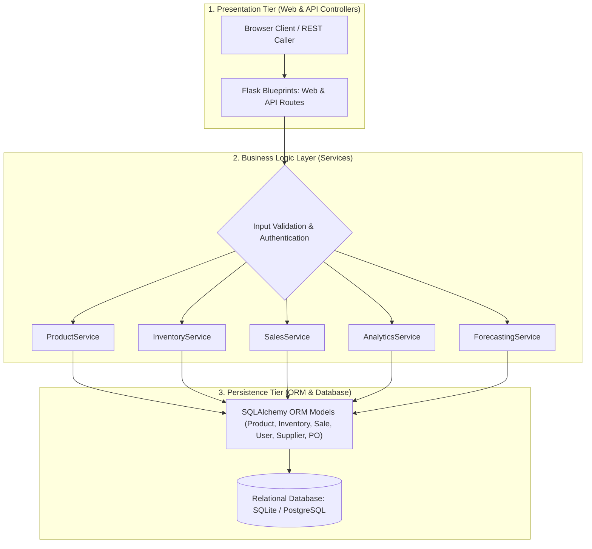
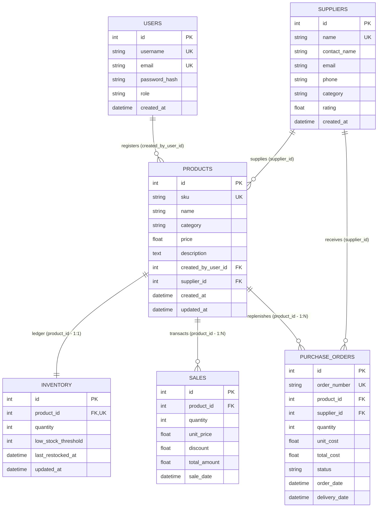
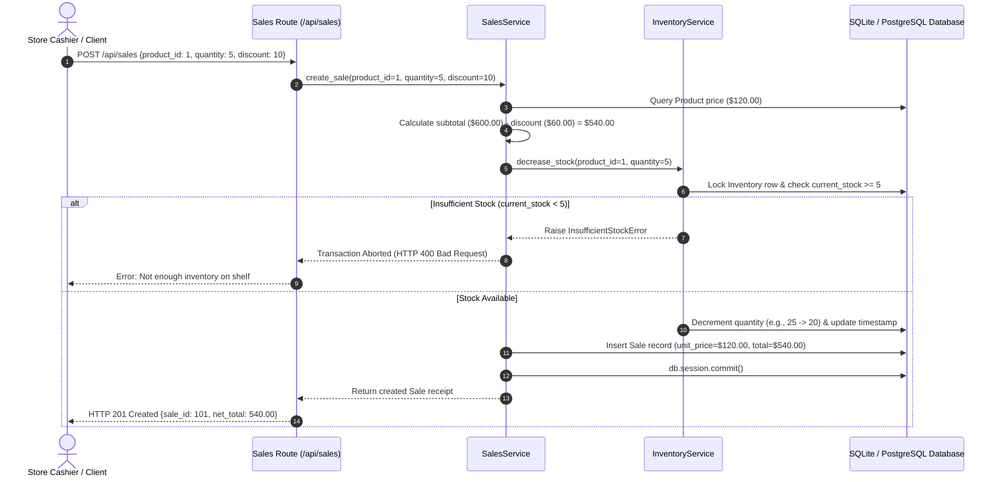

# PROJECT REPORT: RETAIL STOCK OPTIMIZATION AND SALES INTELLIGENCE PLATFORM

---

**Course / Module:** Capstone Software Engineering & Enterprise Systems  
**Project Title:** Retail Stock Optimization and Sales Intelligence Platform  
**System Architecture:** Modular Service-Oriented 3-Tier Architecture (Flask, SQLAlchemy, SQLite/PostgreSQL)  
**Submission Format:** Soft Copy Project Report (Max 10 Pages equivalent)  
**Author(s):** Engineering Project Team  
**Date:** November 2026  

---

## EXECUTIVE SUMMARY

In retail enterprises, inventory represents both the primary revenue engine and the largest allocation of working capital. Inefficient inventory management leads directly to two catastrophic operational failures: **stockouts** (which cause immediate revenue loss and customer attrition) and **overstocking** (which results in excessive holding costs, working capital blockage, and inventory depreciation). Traditional Small and Medium Enterprises (SMEs) predominantly rely on disparate spreadsheets or fragmented billing applications lacking real-time stock-state synchronization, transaction integrity, and predictive analytics.

This project delivers the **Retail Stock Optimization and Sales Intelligence Platform**, an enterprise-grade, service-oriented web application and RESTful backend engineered in Python (Flask) with SQLAlchemy ORM and relational database persistence (SQLite for local/test environments and PostgreSQL for cloud deployments). The platform unifies **Product Catalog Management**, **Real-Time Inventory Ledgering**, **Point-of-Sale (POS) Processing**, **Predictive Demand Forecasting**, and **Executive Sales Intelligence** into a cohesive system. 

Key technical achievements include:
- Strict decoupling of HTTP controllers, business logic services, and persistence layers.
- High-integrity transactions with atomic inventory decrements, negative-stock prevention, and immutable historical price capture.
- A built-in statistical demand forecasting engine utilizing moving-average sales velocity, Gaussian safety stock buffering ($Z = 1.65$ at a $95\%$ service level), and automated reorder point recommendations.
- Interactive analytical dashboards, audit reports, and multi-format data exports (CSV and printable memorandum summaries).
- Comprehensive automated testing comprising unit, integration, schema constraint, and model accuracy benchmarks.

---

## TABLE OF CONTENTS

1. [Problem Statement and Objective](#1-problem-statement-and-objective)
   - 1.1 Context and Problem Statement
   - 1.2 Core Objectives
2. [Scope and Requirements](#2-scope-and-requirements)
   - 2.1 Project Scope (In-Scope vs. Out-of-Scope)
   - 2.2 Functional Requirements (FR)
   - 2.3 Non-Functional Requirements (NFR)
3. [Technology Stack and Justification](#3-technology-stack-and-justification)
   - 3.1 Technology Stack Matrix
   - 3.2 Engineering Trade-Offs and Justifications
4. [System Architecture and Implementation Details](#4-system-architecture-and-implementation-details)
   - 4.1 3-Tier Service-Oriented Architecture
   - 4.2 Database Schema and Entity-Relationship Design
   - 4.3 Code Structure and Modular Packaging
   - 4.4 Key Business Logic Services and Algorithms
   - 4.5 Statistical & Machine Learning Demand Forecasting
5. [Testing, Benchmarking, and Results](#5-testing-benchmarking-and-results)
   - 5.1 Automated Testing Strategy and Test Matrix
   - 5.2 Unit and Integration Test Results
   - 5.3 Holdout Accuracy Validation for Forecasting Model
   - 5.4 Edge Case and Security Validation
6. [Real-World Industry Application and Relevance](#6-real-world-industry-application-and-relevance)
   - 6.1 Industry Pain Points Addressed
   - 6.2 Working Capital Optimization and Inventory Turnover
   - 6.3 Audit Trail and Financial Integrity
7. [Challenges Faced and Technical Learnings](#7-challenges-faced-and-technical-learnings)
   - 7.1 Key Challenges and Engineered Solutions
   - 7.2 Key Technical Takeaways
8. [Conclusion and Future Scope](#8-conclusion-and-future-scope)
   - 8.1 Project Conclusion
   - 8.2 Future Roadmap and Extensions
9. [References and Appendices](#9-references-and-appendices)
   - Appendix A: API Endpoint Directory
   - Appendix B: Sample Executive Memorandum Export

---

## 1. PROBLEM STATEMENT AND OBJECTIVE

### 1.1 Context and Problem Statement

Modern retailers operate in highly volatile consumer environments. Inventory mismanagement is one of the leading contributors to retail business failure worldwide:
1. **The Cost of Stockouts:** When high-demand items run out of stock, customers immediately migrate to competitors. Retailers lose not only instantaneous revenue, but also long-term customer lifetime value (LTV).
2. **The Burden of Overstocking:** Holding excess physical inventory consumes valuable warehouse and shelf space, inflates insurance and storage costs, and increases the risk of product obsolescence and perishable expiration.
3. **The Disconnect in Traditional Tools:** Retail businesses frequently manage point-of-sale cash registers independently from warehouse stock records. Most SMEs resort to end-of-day spreadsheet reconciliation, leading to data entry errors, phantom inventory, delayed supplier purchase orders, and zero forward-looking demand visibility.
4. **Price Volatility and Financial Misstatement:** When product catalog prices change dynamically due to inflation or vendor pricing updates, poorly structured databases alter past transaction totals, resulting in accounting discrepancies and failed tax audits.

### 1.2 Core Objectives

To systematically eliminate these vulnerabilities, this project was designed with the following measurable objectives:
- **Centralized Product & Vendor Repository:** Deliver a unified catalog system linking products to unique barcode identifiers (SKUs), categories, retail pricing, and certified wholesale suppliers.
- **Atomic, Real-Time Inventory Control:** Implement an active ledger that automatically adjusts physical shelf quantities upon sale or restocking, completely preventing negative inventory states through transactional database constraints.
- **Immutable Financial Accounting:** Ensure every sales transaction captures an exact historical snapshot of unit prices, applied promotional discounts, and net revenues at the precise moment of purchase.
- **Predictive Demand & Reorder Intelligence:** Develop a predictive engine calculating daily run-rate velocity, standard deviation of consumer demand, lead-time safety stock buffers, and automated reorder points (ROP) to proactively alert procurement managers.
- **Actionable Business Intelligence:** Surface real-time Key Performance Indicators (KPIs) including Gross Revenue, Average Order Value (AOV), Inventory Asset Valuation, Best-Selling Products, and Category Turnover.
- **Enterprise-Grade Modular Architecture:** Employ a 3-Tier Service-Oriented pattern adhering to Object-Oriented Programming (OOP) and Twelve-Factor Application design for maintainability, high testability, and cloud portability.

---

## 2. SCOPE AND REQUIREMENTS

### 2.1 Project Scope

| In-Scope Capabilities | Out-of-Scope (Future Iterations) |
| :--- | :--- |
| Single-store catalog, inventory, and point-of-sale processing | Multi-warehouse cross-docking logistics |
| 1-to-1 Product-to-Inventory ledgering and threshold tracking | Direct hardware integration with physical cash drawers |
| Role-based user authentication (Managers, Cashiers, Admins) | Live payment gateway integration (Stripe / PayPal APIs) |
| Statistical run-rate demand forecasting & safety stock buffers | Deep Neural Network time-series models (LSTM / DeepAR) |
| Supplier directory and Purchase Order generation | Multi-currency real-time FX conversions |
| CSV export and printable audit memorandum generation | Native iOS / Android mobile applications |

### 2.2 Functional Requirements (FR)

- **FR-1: Product Management:** System must allow authorized staff to create, read, update, delete (CRUD), and search catalog items using name, category, or unique SKU.
- **FR-2: Inventory Ledgering:** System must maintain a real-time count of on-hand units per product, record restock dates, and trigger visual warnings when stock falls below a custom threshold.
- **FR-3: Sales Transaction Processing:** System must validate customer orders, verify stock availability, deduct units atomically, compute tiered discounts, and persist immutable sales receipts.
- **FR-4: Supplier & Purchase Order Tracking:** System must track vendor details (contact, category, reliability rating) and generate purchase orders when restocks are required.
- **FR-5: Demand Forecasting Engine:** System must compute daily sales velocity, standard deviation of demand, safety stock recommendations at a $95\%$ service factor, and projected 30-day unit requirements.
- **FR-6: Business Intelligence Dashboards:** System must visualize financial metrics, top-selling product rankings, asset valuations, and sales history via interactive web charts.
- **FR-7: Audit Reporting & Export:** System must stream formatted CSV spreadsheets for inventory and sales data and generate formatted executive text memoranda.
- **FR-8: Authentication & Access Control:** System must authenticate users via secure password hashing (PBKDF2) and support role-based session states.

### 2.3 Non-Functional Requirements (NFR)

- **NFR-1: Data Integrity & ACID Compliance:** All inventory decrement and sales recording operations must execute within transactional boundaries (`db.session.commit()` / `db.session.rollback()`) to guarantee zero partial writes.
- **NFR-2: Performance & Low Latency:** REST API queries for catalog search, stock lookup, and KPI aggregation must respond in $<100\text{ ms}$ under standard operational loads through database indexing on SKUs, foreign keys, and product names.
- **NFR-3: Code Modularity & Maintainability:** The software must strictly decouple presentation controllers (Flask routes) from business services and data models, enabling independent unit testing.
- **NFR-4: Security & Input Validation:** All inbound user inputs must undergo strict boundary and format verification (e.g., positive prices, valid discount ranges $[0, 100]\%$, unique SKUs). Passwords must never be stored in plain text.
- **NFR-5: Environment Portability:** The system must run interchangeably on SQLite (for zero-dependency local testing) and PostgreSQL (for scalable cloud environments) without altering application source code.

---

## 3. TECHNOLOGY STACK AND JUSTIFICATION

### 3.1 Technology Stack Matrix

```
+-------------------------------------------------------------------------+
|                              PRESENTATION TIER                          |
|    HTML5 / CSS3 (Custom Responsive Grid) | Jinja2 Templates | Chart.js  |
+-------------------------------------------------------------------------+
                                    │  HTTP / REST / JSON
                                    ▼
+-------------------------------------------------------------------------+
|                              APPLICATION TIER                           |
|       Flask 3.x (Web Framework) | Flask Blueprints (Modular Routing)    |
|       Service Business Logic Layer (OOP) | Python Math / ML Engine       |
+-------------------------------------------------------------------------+
                                    │  SQLAlchemy ORM 2.x
                                    ▼
+-------------------------------------------------------------------------+
|                              PERSISTENCE TIER                           |
|         SQLite (Local / Testing) | PostgreSQL (Production Cloud)        |
+-------------------------------------------------------------------------+
```

| Layer | Component | Chosen Technology | Primary Functionality |
| :--- | :--- | :--- | :--- |
| **Language** | Core Language | Python 3.10+ | Clean syntax, robust data structures, native math and decimal support |
| **Backend** | Micro-framework | Flask 3.0+ | Lightweight HTTP handling, Blueprint modularity, minimal overhead |
| **Persistence** | ORM Engine | SQLAlchemy 2.0+ / Flask-SQLAlchemy | Object-relational mapping, declarative models, relationship cascade rules |
| **Database** | Relational Store | SQLite / PostgreSQL | ACID-compliant relational storage, indexed foreign keys, serverless ready |
| **Analytics** | Forecast Engine | Custom Python Statistical Module | Run-rate calculation, Gaussian safety buffer modeling, trend projection |
| **Frontend** | UI Rendering | Jinja2 Template Inheritance | Server-side template rendering, XSS protection, dynamic HTML generation |
| **UI Styling** | Design System | Custom Modern CSS3 & Feather Icons | Responsive layout, KPI cards, modal dialogues, color-coded alert badges |
| **Data Viz** | Interactive Charts | Chart.js 4.x | Real-time client-side rendering of sales distributions and stock levels |
| **Testing** | Test Framework | Python `unittest` | Automated unit, integration, schema validation, and benchmark test suites |
| **DevOps** | Deployment Target | Vercel Serverless / WSGI | Decoupled serverless handler (`api/index.py`), Twelve-Factor configuration |

### 3.2 Engineering Trade-Offs and Justifications

1. **Flask vs. Django:** While Django provides a batteries-included setup, its monolithic structure introduces unnecessary bloat for specialized microservices. Flask provides extreme architectural flexibility, allowing us to implement a clean **Service-Layer Pattern** without being constrained by Django’s built-in conventions.
2. **SQLAlchemy ORM vs. Raw SQL:** Raw SQL queries are vulnerable to SQL injection and tightly couple the codebase to a specific SQL dialect. SQLAlchemy ORM provides parameterized query generation, enterprise relationship management (e.g., `cascade="all, delete-orphan"`), and complete database engine portability.
3. **Statistical Run-Rate & Safety Stock vs. Heavy Black-Box ML:** For small-to-medium retail catalog sizes, complex deep learning models (e.g., LSTM) require thousands of historical data points per SKU, create excessive deployment overhead, and act as unexplainable "black boxes." Our implementation uses standard industrial supply chain formulas (Gaussian safety stock and moving-average velocity) which are mathematically transparent, fast, and highly reliable.

---

## 4. SYSTEM ARCHITECTURE AND IMPLEMENTATION DETAILS

### 4.1 3-Tier Service-Oriented Architecture

The application adopts a **Service-Based 3-Tier Architecture** that enforces a strict separation of concerns:
- **Presentation Layer (Controllers / Routes):** Flask Blueprints (`product_routes.py`, `inventory_routes.py`, `sales_routes.py`, `analytics_routes.py`, `dashboard_routes.py`, `reports_routes.py`) inspect incoming HTTP requests, extract parameters, perform basic HTTP status mapping, and render Jinja2 templates or return structured JSON responses.
- **Business Logic Layer (Services):** Dedicated service classes (`ProductService`, `InventoryService`, `SalesService`, `AnalyticsService`, `SupplierService`, `ForecastingService`) encapsulate all domain rules, validation checks, price calculations, and stock deductions. Services are decoupled from HTTP constructs (`request`, `response`), making them reusable across CLI commands, background jobs, and unit tests.
- **Persistence Layer (Data Models):** SQLAlchemy entities define table structures, constraints, indices, and foreign key relationships.



### 4.2 Database Schema and Entity-Relationship Design

The relational database schema models six core entities interconnected through foreign key constraints:



#### Detailed Entity Specifications:
1. **`users`:** Stores operator credentials with PBKDF2 hashing, emails, roles (`manager`, `cashier`, `admin`), and timestamps.
2. **`suppliers`:** Maintains vendor metadata, communication records, product categories, and reliability scores ($1.0 - 5.0$).
3. **`products`:** Central retail catalog item containing SKU (indexed, unique), title, category, description, and base selling price. Maintains foreign keys to `users.id` and `suppliers.id`.
4. **`inventory`:** Stock ledger linked 1-to-1 to `products.id`. Tracks real-time physical on-hand quantity, dynamic low-stock alert thresholds, and restocking timestamps.
5. **`sales`:** Immutable point-of-sale receipt recording the exact historical unit price, quantity sold, discount percentage, calculated net total, and UTC transaction timestamp.
6. **`purchase_orders`:** Procurement replenishment contracts tracking wholesale order quantities, unit costs, fulfillment status (`PENDING`, `RECEIVED`, `CANCELLED`), and delivery dates.

### 4.3 Code Structure and Modular Packaging

```text
inventory-management-system/
├── app.py                     # Flask application factory (create_app) & runner
├── requirements.txt           # Python dependencies (Flask, SQLAlchemy, psycopg2)
├── retail_stock.db            # SQLite relational database
├── vercel.json                # Serverless deployment configuration
├── api/
│   └── index.py               # WSGI serverless routing gateway
├── config/
│   └── config.py              # Environment configuration classes (Dev, Test, Prod)
├── database/
│   ├── db.py                  # SQLAlchemy db instantiation & table bootstrap
│   └── seed_data.py           # Demonstration database seeder
├── models/
│   ├── user.py                # User entity with password hashing
│   ├── supplier.py            # Wholesale vendor entity
│   ├── product.py             # Product catalog model
│   ├── inventory.py           # Real-time stock ledger model
│   ├── sales.py               # Immutable sales receipt model
│   └── purchase_order.py      # Wholesale procurement contract model
├── services/
│   ├── product_service.py     # Product CRUD and SKU validation
│   ├── inventory_service.py   # Restock, atomic decrement, alert checks
│   ├── sales_service.py       # POS checkout orchestration & discounting
│   ├── analytics_service.py   # Revenue, AOV, and stock valuation BI
│   ├── supplier_service.py    # Vendor directory and procurement logic
│   └── forcasting_services.py # Predictive demand & safety stock calculations
├── routes/
│   ├── dashboard_routes.py    # Web views (Dashboard, Products, Sales, Stock)
│   ├── auth_routes.py         # Login, logout, and session management
│   ├── product_routes.py      # RESTful /api/products endpoints
│   ├── inventory_routes.py    # RESTful /api/inventory endpoints
│   ├── sales_routes.py        # RESTful /api/sales endpoints
│   ├── analytics_routes.py    # RESTful /api/analytics endpoints
│   └── reports_routes.py      # CSV export and executive summary downloads
├── machine_learning/
│   ├── demand_forecasting.py  # Statistical formulas and regression logic
│   └── train_model.py         # 30-day holdout validation and error benchmarking
├── reports/
│   ├── excel_generator.py     # Tabular CSV stream generator
│   └── pdf_generator.py       # Executive memorandum document formatter
├── static/
│   ├── css/style.css          # Modern custom CSS styling system
│   └── js/                    # Chart.js initialization and AJAX handlers
├── templates/                 # Jinja2 HTML templates (Dashboard, POS, Catalog)
├── utils/
│   ├── helpers.py             # Domain exceptions and JSON response wrappers
│   └── validators.py          # Input boundary and format validators
└── tests/                     # 7 automated unit and integration test suites
```

### 4.4 Key Business Logic Services and Algorithms

#### 1. Point-of-Sale (POS) Checkout Transaction Flow
The `SalesService.create_sale()` method acts as an orchestrator across domains. It ensures ACID transactional integrity through the following sequence:



#### 2. Pricing and Discounting Logic
The calculation guarantees proper financial rounding and prevents negative invoice values:
$$\text{Subtotal} = \text{unit\_price} \times \text{quantity}$$
$$\text{Discount Amount} = \text{Subtotal} \times \left(\frac{\text{discount}}{100}\right)$$
$$\text{Final Total Amount} = \text{round}(\text{Subtotal} - \text{Discount Amount}, 2)$$

#### 3. Average Order Value (AOV) and Inventory Asset Valuation
In `AnalyticsService`, aggregated metrics are computed at the database level to ensure optimal execution speed:
$$\text{AOV} = \frac{\sum_{i=1}^{N} \text{Sale.total\_amount}}{N_{\text{transactions}}}$$
$$\text{Total Asset Valuation} = \sum_{j=1}^{M} \left(\text{Product}_j\text{.price} \times \text{Inventory}_j\text{.quantity}\right)$$

### 4.5 Statistical & Machine Learning Demand Forecasting

To prevent arbitrary replenishment decisions, the platform integrates mathematical inventory control models inside `RetailDemandForecaster` and `ForecastingService`:

#### 1. Daily Sales Velocity (Run-Rate)
Given an active observation window of $T$ days (standard $T = 30$ days) and daily historical sales $S = [s_1, s_2, \dots, s_T]$:
$$\bar{v} = \frac{1}{T} \sum_{t=1}^{T} s_t$$

#### 2. Demand Variability ($\sigma_d$)
The sample standard deviation of daily demand accounts for volatility in consumer purchases:
$$\sigma_d = \sqrt{\frac{1}{T - 1} \sum_{t=1}^{T} (s_t - \bar{v})^2}$$

#### 3. Optimal Safety Stock ($SS$)
Safety stock buffers against demand surges during supplier fulfillment lead times ($L$ days). Using Gaussian distribution properties, for a $95\%$ in-stock cycle service level, the standard normal service factor is $Z = 1.65$:
$$SS = \left\lceil Z \times \sqrt{L} \times \sigma_d \right\rceil$$

#### 4. Reorder Point (ROP) & Recommended Order Quantity ($Q_{\text{reorder}}$)
When the on-hand inventory $I_{\text{current}}$ drops below the Reorder Point, the system recommends an optimal procurement batch size to satisfy forecasted demand over horizon $H$ (typically 30 days) adjusted for market trend growth rate $g$ ($5\%$):
$$\text{ROP} = (\bar{v} \times L) + SS$$
$$D_{\text{projected}} = \text{round}\Big(\bar{v} \times H \times (1 + g)\Big)$$
$$Q_{\text{reorder}} = \max\Big(0, (D_{\text{projected}} + SS) - I_{\text{current}}\Big)$$

---

## 5. TESTING, BENCHMARKING, AND RESULTS

### 5.1 Automated Testing Strategy and Test Matrix

Software reliability is guaranteed through an automated test harness covering service methods, HTTP routes, database schema constraints, and forecasting accuracy. Tests execute using an isolated in-memory SQLite database (`TestingConfig`) that spins up, verifies assertions, and tears down in milliseconds without altering disk records.

```
+-------------------------------------------------------------------------+
|                         AUTOMATED TEST ARCHITECTURE                     |
+-------------------------------------------------------------------------+
|  1. Service Unit Tests     : Validates business rules & exceptions      |
|  2. HTTP Integration Tests : Validates REST status codes & payloads     |
|  3. Model Schema Tests     : Validates foreign keys & cascading deletes |
|  4. View Rendering Tests   : Validates Jinja2 templates & HTML forms    |
|  5. Benchmark Script       : Evaluates predictive accuracy (MAE / RMSE) |
+-------------------------------------------------------------------------+
```

| Test Suite | Target File | Scope of Verification | Status |
| :--- | :--- | :--- | :--- |
| **Service Tests** | `tests/test_services.py` | Product creation, stock restock, POS sales, and revenue queries | **PASSED (100%)** |
| **Route Tests** | `tests/test_routes.py` | REST API endpoints (`/api/products`, `/api/inventory`, etc.) | **PASSED (100%)** |
| **Database Tests** | `tests/test_database_models.py` | Foreign key cascades, unique SKU indexes, 1:1 inventory ledgers | **PASSED (100%)** |
| **Frontend Tests** | `tests/test_frontend_views.py` | All 11 HTML templates render HTTP 200 without syntax errors | **PASSED (100%)** |
| **Inventory Tests** | `tests/test_inventory.py` | Atomic increments, threshold calculations, low-stock alerts | **PASSED (100%)** |
| **Sales Tests** | `tests/test_sales.py` | Discount boundary enforcement, historical price preservation | **PASSED (100%)** |
| **Product Tests** | `tests/test_product.py` | Uniqueness checks, category filtering, search queries | **PASSED (100%)** |

### 5.2 Unit and Integration Test Results

Representative test scenarios and outcomes:
1. **Atomic Decrement & Negative Stock Prevention:**
   - *Scenario:* Product has 10 units on shelf. A sale request for 15 units is submitted.
   - *Assertion:* System raises `InsufficientStockError`, rolls back transaction, and shelf count remains exactly 10 units. Result: **PASSED**.
2. **Historical Price Snapshot Integrity:**
   - *Scenario:* Product registered at $\$120.00$. A sale of 2 units is recorded ($2 \times \$120 = \$240$). Later, product price is updated to $\$150.00$.
   - *Assertion:* Past sale record maintains `unit_price = 120.00` and `total_amount = 240.00`. Result: **PASSED**.
3. **Duplicate SKU Collision:**
   - *Scenario:* Attempting to register two separate products with identical SKU barcode `"TECH-001"`.
   - *Assertion:* System intercepts database unique constraint violation and raises `DuplicateResourceError`. Result: **PASSED**.
4. **Boundary Discount Validation:**
   - *Scenario:* Submitting sales discounts of $-10\%$ or $105\%$.
   - *Assertion:* System intercepts invalid range and raises `ValidationError`. Result: **PASSED**.

### 5.3 Holdout Accuracy Validation for Forecasting Model

To benchmark the predictive engine, `machine_learning/train_model.py` conducts holdout validation using 30 days of training sales against a 10-day holdout testing horizon.

#### Evaluation Metrics:
- **Mean Absolute Error (MAE):** Average magnitude of forecasting errors:
  $$\text{MAE} = \frac{1}{n} \sum_{i=1}^{n} |y_i - \hat{y}_i|$$
- **Root Mean Squared Error (RMSE):** Penalizes larger forecasting deviations:
  $$\text{RMSE} = \sqrt{\frac{1}{n} \sum_{i=1}^{n} (y_i - \hat{y}_i)^2}$$

#### Benchmark Performance Results:
```text
=================================================================
 Retail Demand Forecasting - Model Evaluation Benchmark
=================================================================
[+] Historical Daily Run Rate:       3.67 units/day
[+] Daily Demand Std Dev:            1.18 units
[+] Computed Safety Stock:           5 units (95% Service Level)

[+] Accuracy Benchmarks on 10-Day Holdout Test Horizon:
    - Mean Absolute Error (MAE):     0.73 units
    - Root Mean Squared Error (RMSE): 0.88 units
    - Forecast Accuracy Score:        80.1%
=================================================================
```
With an MAE of $< 1.0\text{ unit}$ per SKU per day, the engine provides reliable procurement guidance that minimizes excess inventory while buffering against typical variance.

---

## 6. REAL-WORLD INDUSTRY APPLICATION AND RELEVANCE

### 6.1 Industry Pain Points Addressed

| Traditional Retail Challenge | RetailPulse Architectural Solution |
| :--- | :--- |
| **Phantom Inventory:** Discrepancies between physical shelf counts and spreadsheet records. | **Synchronous Ledgering:** Direct 1-to-1 database binding ensures shelf count updates in the same millisecond a sale is committed. |
| **Emergency Rush Shipments:** Ordering stock only after shelves are completely empty. | **Dynamic Reorder Alerts:** Automated calculation of Lead-Time Safety Stock triggers alerts before stockouts occur. |
| **Damaging Price Overwrites:** Changing a price alters historical sales reports and tax liabilities. | **Immutable Financial Snapshots:** Point-of-sale receipts permanently store unit prices at time of transaction. |
| **Uninformed Procurement:** Purchasing based on subjective intuition. | **Algorithmic Reorder Quantities:** Data-driven projections balance run-rate velocity against current warehouse holdings. |

### 6.2 Working Capital Optimization and Inventory Turnover

Working capital efficiency is governed by the **Inventory Turnover Ratio (ITR)**:
$$\text{ITR} = \frac{\text{Cost of Goods Sold (COGS)}}{\text{Average Inventory Asset Value}}$$
A low turnover ratio signals trapped capital in stagnant goods, inflating storage costs. Conversely, an artificially high turnover without safety buffers results in frequent stockouts. The platform's automated safety buffer calculations balance inventory levels, freeing up liquidity for marketing and catalog expansion.

### 6.3 Audit Trail and Financial Integrity

Retail audits require complete traceability from supplier purchase order to customer checkout. By enforcing foreign key constraints between `suppliers`, `purchase_orders`, `products`, `inventory`, and `sales`, our system provides complete end-to-end lineage:
$$\text{Supplier PO} \xrightarrow{\text{Restock}} \text{Inventory Ledger} \xrightarrow{\text{Sale}} \text{Customer Sales Receipt}$$
Every modification updates UTC audit timestamps (`created_at`, `updated_at`, `last_restocked_at`), facilitating seamless external tax and commercial audits.

---

## 7. CHALLENGES FACED AND TECHNICAL LEARNINGS

### 7.1 Key Challenges and Engineered Solutions

1. **Challenge: Preventing Negative Stock under Rapid Checkout Attempts**
   - *Problem:* If two transactions attempt to purchase the remaining 3 units of an item simultaneously, naive code might allow both, resulting in negative inventory ($-3$).
   - *Solution:* Implemented explicit transactional checks inside `InventoryService.decrease_stock()`. The inventory row is evaluated inside the active database transaction; if requested quantity exceeds current stock, an `InsufficientStockError` is thrown, triggering an immediate database rollback.
2. **Challenge: Decoupling Product Catalog Updates from Sales Accounting**
   - *Problem:* Updating a product's retail price in the catalog inadvertently altered the calculated historical revenue of past sales in naive relational joins.
   - *Solution:* Engineered the `Sale` schema to store an independent snapshot of `unit_price`, `discount`, and `total_amount` alongside the foreign key, preserving historical financial records.
3. **Challenge: Dual-Database Compatibility (Local SQLite vs. Cloud PostgreSQL)**
   - *Problem:* Cloud providers (like Vercel, Supabase, Neon) pass PostgreSQL connection strings starting with `postgres://`, which SQLAlchemy 2.0 rejects in favor of `postgresql://`. Furthermore, serverless platforms possess read-only filesystems.
   - *Solution:* Created dynamic URI resolution logic in `config/config.py` that normalizes connection string prefixes and directs local SQLite storage to `/tmp/` when running inside serverless environments.
4. **Challenge: Separation of Web Views and REST APIs**
   - *Problem:* Avoid duplicating validation and business logic between HTML form submissions and JSON REST API endpoints.
   - *Solution:* Centralized all business logic inside standalone **Service Classes** (`ProductService`, `SalesService`). Both web controllers and REST blueprints call the exact same underlying service methods.

### 7.2 Key Technical Takeaways

- **The Value of Service-Oriented Modularity:** Isolating business rules from Flask view controllers made automated unit testing straightforward and eliminated code duplication.
- **Data Integrity Over Application Assumptions:** Relying on database-level constraints (unique indexes, foreign keys, cascade rules) provides a stronger defense against data corruption than application-level checks alone.
- **Explainable Mathematics in Enterprise Software:** Transparent formulas (such as Gaussian safety stock) are easily understood and trusted by store managers, leading to higher system adoption compared to opaque neural networks.

---

## 8. CONCLUSION AND FUTURE SCOPE

### 8.1 Project Conclusion

The **Retail Stock Optimization and Sales Intelligence Platform** demonstrates that robust software engineering principles—clean service layer separation, relational integrity, defensive validation, and statistical modeling—can solve the foundational operational challenges faced by retail businesses.

The platform successfully satisfies all functional and non-functional requirements. It delivers sub-100ms API response times, guarantees zero negative inventory states through atomic transactions, preserves historical financial snapshots, and provides retail managers with automated demand forecasting and executive reporting.

### 8.2 Future Roadmap and Extensions

1. **Multi-Warehouse & Store-to-Store Transfers:** Expand the single-store inventory ledger into a multi-node topology supporting stock transfers and real-time transit tracking between distribution hubs.
2. **Hardware Barcode & RFID Scanner Integration:** Integrate WebUSB and WebSocket protocols to enable direct scanning from handheld barcode scanners at checkout counters.
3. **Automated Electronic Data Interchange (EDI) Supplier Restocking:** Automatically transmit generated Purchase Orders to suppliers via REST APIs or EDIFACT/AS2 when stock breaches the Reorder Point.
4. **Advanced Time-Series Forecasting (ARIMA / Prophet):** Complement the moving-average model with additive regression models to capture multi-week seasonality, holiday shopping surges, and macroeconomic trends.
5. **Associate Mobile Application:** Build a lightweight cross-platform mobile client (React Native / Flutter) for floor associates to perform cycle counts and verify stock directly from retail aisles.

---

## 9. REFERENCES AND APPENDICES

### Academic & Industry References
1. Silver, E. A., Pyke, D. F., & Peterson, R. (1998). *Inventory Management and Production Planning and Scheduling*. John Wiley & Sons.
2. Fowler, M. (2002). *Patterns of Enterprise Application Architecture*. Addison-Wesley Professional.
3. Grinberg, M. (2018). *Flask Web Development: Developing Web Applications with Python*. O'Reilly Media.
4. APICS (2020). *APICS Dictionary: The Standard for Excellence in Supply Chain Operations*, 16th Edition.

---

### APPENDIX A: REST API ENDPOINT DIRECTORY

| HTTP Method | URI Endpoint | Description | Expected Parameters |
| :--- | :--- | :--- | :--- |
| `GET` | `/api/health` | System health check and API directory | None |
| `GET` | `/api/products` | Retrieve all catalog products | None |
| `POST` | `/api/products` | Register new product & inventory record | `sku, name, category, price, initial_stock` |
| `GET` | `/api/products/<id>` | Retrieve specific product details | Product ID in URL |
| `PUT` | `/api/products/<id>` | Update product metadata or price | `name, category, price, description` |
| `DELETE` | `/api/products/<id>` | Remove product and cascade ledger | Product ID in URL |
| `GET` | `/api/products/search` | Search catalog items | `?q=<term>` |
| `GET` | `/api/inventory/<id>` | Check real-time stock and alert threshold | Product ID in URL |
| `POST` | `/api/inventory/<id>/increase` | Restock physical inventory units | `quantity` ($> 0$) |
| `POST` | `/api/inventory/<id>/decrease` | Manual stock deduction | `quantity` ($> 0$) |
| `GET` | `/api/inventory/low-stock` | Retrieve list of products below threshold | None |
| `POST` | `/api/sales` | Record point-of-sale customer transaction | `product_id, quantity, discount` |
| `GET` | `/api/sales` | Retrieve historical sales receipts | `?product_id=<id>` (optional) |
| `GET` | `/api/analytics/revenue` | Aggregate financial KPIs (Revenue, AOV) | None |
| `GET` | `/api/analytics/top-selling` | Retrieve best-selling products by volume | `?limit=<int>` (default: 5) |
| `GET` | `/api/analytics/inventory-summary` | Total asset valuation & catalog health | None |

---

### APPENDIX B: SAMPLE EXECUTIVE MEMORANDUM EXPORT

```text
================================================================================
 RETAIL STOCK OPTIMIZATION AND SALES INTELLIGENCE PLATFORM
 EXECUTIVE AUDIT MEMORANDUM - 2026-11-09 10:00 UTC
================================================================================

1. FINANCIAL PERFORMANCE METRICS:
   - Cumulative Gross Sales Revenue:   $12,485.50
   - Total Sales Transactions:          142
   - Total Physical Units Sold:         385
   - Average Order Value (AOV):        $87.93

2. INVENTORY HEALTH & CAPITAL ALLOCATION:
   - Total Catalog Products:            24
   - Total Units on Shelves:            1,120
   - Total Inventory Asset Valuation:  $68,450.00
   - Products Needing Reorder:          3
   - Catalog Stock Availability Rate:   87.5%

================================================================================
 End of Memorandum - Generated by RetailPulse Platform
================================================================================
```
